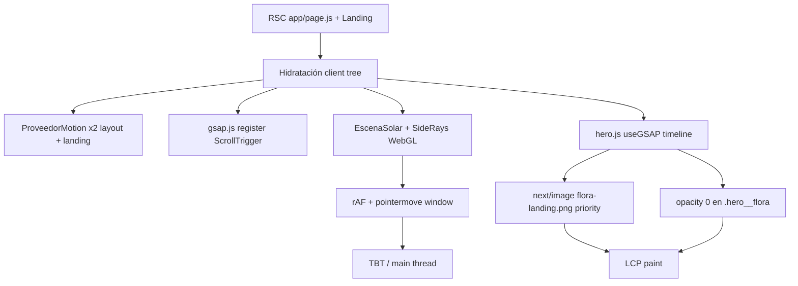

# Auditoría técnica Lighthouse — Enflora (landing `/`)

**Alcance:** rendimiento, accesibilidad, buenas prácticas y SEO de la landing principal (`app/page.js` → `componentes/landing/landing.js`).  
**Restricción respetada:** solo lectura del código y mediciones; **sin cambios** en implementación, dependencias ni configuración.  
**Fecha:** 28 oct 2026.

---

## Resumen ejecutivo

La landing concentra casi toda su UI en **~57 componentes `"use client"`**, animaciones **GSAP + ScrollTrigger**, **Motion**, **WebGL** (`SideRays`, `Particles`) y un volumen muy alto de **PNG/JPG sin WebP/AVIF** (~**14,5 MiB** en disco para los assets referenciados). Eso encaja con el perfil Lighthouse que reportaste: **Performance 56**, **TBT ~1 s**, **LCP ~4,3 s**, **~509 KiB JS no usado**, **~1554 KiB en imágenes**, **CLS 0** (bien resuelto) y **SEO 100**.

**Causas principales confirmadas (con archivo):**

1. **LCP:** ilustración del hero (`/images/flora-landing.png`) dentro de `TiltedCard` + animación GSAP que parte en **opacity 0** + costo de hidratación/JS antes del paint estable.
2. **Imágenes:** decenas de PNG grandes (galería Flora, fondos de regalo, carrusel en CSS, mockups de producto) servidos con `next/image` pero con **dimensiones de origen muy superiores** al tamaño en pantalla móvil.
3. **JavaScript:** chunk principal de landing (~**340 KiB**) que incluye **GSAP, ScrollTrigger y `particles.js`**; segundo chunk grande con **Supabase** (~**254 KiB**) arrastrado por el layout compartido; **cero** `next/dynamic` en la landing.
4. **Hilo principal:** pinning + **clip-path / inset / top-left** en `con-enflora.js`, loops **rAF** en WebGL (hero y lanzamiento), **Magic Bento** con `getBoundingClientRect` en scroll/pointer.
5. **CSS global:** `estilos/principal.scss` compila a ~**384 KiB** de CSS para **toda** la app, incluida la landing.
6. **Accesibilidad (97):** fallos de contraste concentrados en **tarjetas Plus de precios**, notas de instalación/contacto y crédito del footer (confirmado en auditoría local de Lighthouse).
7. **Best Practices (77):** cookies de **Spotify embed**, ausencia de **CSP / HSTS / COOP** en `next.config.mjs`, cabecera **`X-Powered-By`**.

**Medición reproducible:** priorizar Lighthouse **mobile** contra **`https://enflora.com.ar/`** en build de producción (no `next dev`). Se ejecutó además `pnpm build` + `next start` local (puerto 3005) y Lighthouse CLI; ver sección *Mediciones locales*.

---

## Hallazgos confirmados vs hipótesis pendientes

| Estado | Tema | Evidencia |
|--------|------|-----------|
| **Confirmado** | LCP ligado al hero Flora | Lighthouse local lista `figure.tilted-card … img` en *uses-responsive-images*; `hero.js` usa `priority` + GSAP `.from(".hero__flora", { opacity: 0, … })`. |
| **Confirmado** | Ahorro masivo en imágenes | Inventario: **29 archivos** ~**14,45 MiB**; fondos `flora-landing-patova.png` (**1,9 MiB**), `flora-register-mobile.png` (**2,0 MiB**), CSS `vertical-carrusel` + `carrusel-desktop` (**~1,15 MiB**). |
| **Confirmado** | JS no usado / parseo | Chunks `.next/static/chunks/2c8n_yn4bl_zb.js` (GSAP+particles) y `0_3qh8pvib-i6.js` (@supabase); Lighthouse local: ~**86 KiB** “unused” en 3 chunks (menor que prod **509 KiB** — ver pendiente). |
| **Confirmado** | Tareas largas / main thread | `con-enflora.js` `pin: true`, anima `clipPath`, `top/right/bottom/left`; `side-rays.js` + `particles.js` rAF; `magic-bento.js` scroll capture + layout reads. |
| **Confirmado** | Contraste a11y | Lighthouse local: **9** nodos; selectores `.precios__*`, `.instalacion__nota`, `.contacto__form-subtitulo`, `.pie__credito`. |
| **Confirmado** | Third-party / Issues | `playlist-flora.js` iframe Spotify; Lighthouse *inspector-issues*: cookie en embed Spotify. |
| **Confirmado** | Sin analizador de bundle configurado | No hay `@next/bundle-analyzer` ni script en `package.json`; análisis hecho por **tamaño de chunks post-build** + búsqueda de strings. |
| **Pendiente** | Coincidencia exacta con Lighthouse de producción (56 / 509 KiB) | Falta corrida Lighthouse guardada contra **enflora.com.ar** con la misma versión desplegada (commit/hash). Local difiere (HTML `no-cache`, red, CDN). |
| **Pendiente** | Mapa exacto chunk → ruta `/` | Next 16 + Turbopack no dejó en repo un manifest legible en `.next/server/app/page*` en este entorno; falta `@next/bundle-analyzer` o `--experimental-analyze` documentado para 16.3.6. |
| **Pendiente** | Contraste en hero / Gooey nav | Cálculo teórico: `#a4c85b` sobre `#f4f8ee` ≈ **1,77:1** (`encabezado-publico` + `_landing.scss`); **no** apareció en los 9 fallos de la corrida local (posiblemente no en viewport o regla distinta en prod). |
| **Descartado como culpable en landing** | `matter-js` / `FolderFloat` | Solo import en `folder-float.js`; **no** hay imports en el árbol de `landing.js`. |
| **Descartado** | Scripts de analytics Firebase/gtag | No hay `next/script` ni gtag en el código de la landing. |
| **Descartado** | Instagram embed | Solo enlaces externos (`INSTAGRAM_URL`), sin widget. |

---

## Recurso LCP e dependencias

### Candidato LCP (confirmado)

| Campo | Valor |
|--------|--------|
| **Elemento** | `` dentro de `figure.tilted-card` → hero Flora |
| **Componentes** | `componentes/landing/hero.js` → `TiltedCard` → `next/image` |
| **Src estático** | `/images/flora-landing.png` (**199 745 B**, **1129×1152** px) |
| **Prioridad** | `priority` en `Image` |
| **sizes** | `(min-width: 90rem) 34rem, (min-width: 64rem) 32rem, (min-width: 48rem) 26rem, 18rem` |

### Cadena de dependencias (por qué tarda el LCP)



**Evidencia clave:**

```30:47:componentes/landing/hero.js
  useGSAP(() => {
    // ...
      tl.from(".hero__linea", { opacity: 0, y: 28, duration: 0.55, stagger: 0.1 }, 0.08)
        // ...
        .from(".hero__flora", { opacity: 0, y: 22, scale: 0.97, duration: 0.7 }, 0.4)
```

```104:112:componentes/landing/hero.js
              <Image
                src="/images/flora-landing.png"
                alt="Flora, la mascota de Enflora, tomando sol en una reposera"
                width={1254}
                height={1254}
                priority
                draggable={false}
                sizes="(min-width: 90rem) 34rem, (min-width: 64rem) 32rem, (min-width: 48rem) 26rem, 18rem"
              />
```

**Nota:** en mobile el slot visual ~**18rem** (~288 px) recibe decodificación de imagen generada desde master **1129 px** → coherente con auditoría *uses-responsive-images* (ahorro estimado **346 KiB** en corrida local, subconjunto de imágenes).

---

## 1. Inventario de imágenes (landing)

### Leyenda

| Columna | Significado |
|---------|-------------|
| **Uso** | Sección / componente |
| **next/image** | Sí / No / CSS `background-image` |
| **loading** | `priority`, lazy (default), o `loading="lazy"` en `` nativo |
| **Peso / px** | Archivo en `public/images` |

### Above the fold / inicio de carga

| Prioridad | Archivo | Peso | Dimensiones | Uso | next/image | Notas |
|-----------|---------|------|-------------|-----|------------|-------|
| **LCP** | `flora-landing.png` | 195 KiB | 1129×1152 | `hero.js` | Sí | `priority`; animación GSAP retrasa opacity |
| Alta | `enflora-logo-apaisado.svg` ×2 | SVG | vector | `encabezado-publico.js` | **No** (``) | Dos logos en DOM |
| Alta | — | — | — | `side-rays` | N/A | WebGL, no imagen |
| Media (CSS) | — | — | — | Hero manchas | CSS | Sin asset raster |

### Sección «Para qué sirve» (RSC `para-que-sirve.js`)

| Archivo | Peso | Dimensiones | sizes | loading |
|---------|------|-------------|-------|---------|
| `flora-landing-registra.png` | 281 KiB | 1672×941 | `(min-width: 64rem) 18rem, … 70vw` | lazy |
| `flora-landing-idea.png` | 173 KiB | 1672×941 | idem | lazy |
| `flora-landing-conoce.png` | 291 KiB | 1672×941 | idem | lazy |
| `flora-landing-produccion.png` | 307 KiB | 1536×1024 | idem | lazy |

Fuente de rutas: `lib/landing.js` (`textos.queEs.tarjetas`).

### «Con Enflora» (fondos CSS, no next/image)

| Archivo | Peso | Dimensiones | Uso |
|---------|------|-------------|-----|
| `vertical-carrusel-landing.png` | 543 KiB | 941×1672 | `_landing.scss` `.con-enflora__media` mobile |
| `carrusel-desktop-landing.png` | 583 KiB | 1672×941 | `_landing.scss` desktop `@media` |

Descarga vía hoja de estilo global; **no** participa en optimización de `next/image`.

### Producto / mockups

| Archivo | Peso | Componente |
|---------|------|------------|
| `demo-mockup-espacios.png` | 363 KiB | `vista-previa-funcionalidad.js` |
| `demo-mockup-registros.png` | 360 KiB | idem |
| `demo-mockup-historial.png` | 418 KiB | idem |

Tres funcionalidades × panel activo; las tres rutas están en el bundle de datos aunque solo una visible.

### Flora (`lib/flora-landing.js` + componentes)

| Archivo | Peso | Componente |
|---------|------|------------|
| `flora-en-la-ofi.png` | 383 KiB | `ficha-flora.js` |
| `flora-DJ.png` | 306 KiB | `playlist-flora.js` (fill) |
| `flora-landingl-selfie.png` | 436 KiB | galería + avatar repetido por ítem |
| Galería 8 ítems | ~**4,2 MiB** sum | `galeria-flora.js` | Precarga por IntersectionObserver + `new Image()` |

### Regalo

| Archivo | Peso | Componente |
|---------|------|------------|
| `flora-landing-patova.png` | **1,82 MiB** | `seccion-regalo.js` desktop |
| `flora-register-mobile.png` | **1,93 MiB** | mobile chat |
| `flora-login-mobile.png` | 667 KiB | mobile post-ticket |

### Instalación

| Archivo | Peso | Componente |
|---------|------|------------|
| `landing-samsung.png` | 159 KiB | `motion.img` lazy |
| `landing iphone.png` | 158 KiB | idem |

### Lanzamiento / modales / pills

| Archivo | Peso | Componente |
|---------|------|------------|
| `flora-astronauta.png` | 251 KiB | `seccion-lanzamiento.js`, modales, pills |

### Expo (en landing)

| Archivo | Peso | Componente |
|---------|------|------------|
| Premios WebP vía config | variable | `seccion-expo.js` (RSC) |
| `flora-ruleta.png` | 284 KiB | `bienvenida-expo.js` (client) |

### Totales orientativos

- **Solo landing (29 rutas inventariadas):** ~**14,45 MiB** en PNG/JPG fuente.
- **Coherencia con Lighthouse ~1554 KiB:** una parte es compresión/formato en red; otra, servir width mayor al display (hero, tarjetas «para qué sirve», galería).

---

## 2. Límites `"use client"` e hidratación

### Server Components confirmados en la ruta

| Archivo | Rol |
|---------|-----|
| `app/page.js` | Metadata, cotización, redirect auth |
| `componentes/landing/landing.js` | Composición (sin `"use client"`) |
| `componentes/landing/para-que-sirve.js` | Contenido estático + `next/image` |
| `componentes/landing/footer.js` | Pie |
| `componentes/landing/seccion-contacto.js` | Shell; formulario es client hijo |
| `componentes/expo-cannabis/seccion-expo.js` | Bloque Expo (parcial RSC) |

### Problema estructural

- **~57 archivos** en `componentes/landing/**` con `"use client"`.
- `landing.js` importa directamente hero, regalo, precios, con-enflora, etc. → **un solo árbol client** enorme desde el primer import client (`ProveedorMotion` → … → `Hero`).
- **`ProveedorMotion` anidado** en `app/layout.js` y otra vez en `landing.js` (doble `MotionConfig` + listener global `dragstart`).
- Layout global sigue montando clientes aunque la landing oculte shell app vía CSS:

```6:16:estilos/paginas/_landing.scss
body:has(.landing) {
  .encabezado,
  .bottom-nav {
    display: none;
  }
}
```

Componentes que **siguen ejecutándose** en `/`: `RegistroServiceWorker`, `ClaseCuerpo`, `AjusteTecladoViewport`, `ProveedorGuardSalidaFlora`, `ModalAccesoPrelanzamiento`, `ProveedorMotion` (layout).

**Oportunidad (sin cambiar diseño):** layout condicional por ruta, `next/dynamic` por secciones bajo fold, extraer subárboles estáticos a RSC (p. ej. listas de texto, FAQ estática).

---

## 3. Paquetes y JavaScript

### Dependencias relevantes en landing

| Paquete | Dónde entra | Impacto |
|---------|-------------|---------|
| `gsap` + `@gsap/react` | `componentes/landing/gsap.js`, hero, con-enflora, revelar, encabezado | ScrollTrigger + timelines |
| `motion` | Casi todas las secciones | Animaciones UI, modales |
| `lucide-react` | Iconos por componente | Riesgo de duplicación si no tree-shake perfecto |
| `@supabase/*` | `proxy.js` + layout app | Chunk **~254 KiB** con string `@supabase` (landing pública no necesita sesión en cliente) |
| `particles.js` / `side-rays.js` | Lanzamiento / hero | Incluidos en chunk **~340 KiB** con GSAP |

### Post-`pnpm build` (evidencia)

| Chunk (aprox.) | Tamaño | Strings detectadas |
|----------------|--------|-------------------|
| `2c8n_yn4bl_zb.js` | 340 KiB | `gsap`, `ScrollTrigger`, `particles` |
| `0_3qh8pvib-i6.js` | 254 KiB | `@supabase` |
| `1_gj8p1968ax3.css` | 384 KiB | CSS global |

### Lighthouse local — bootup (ms scripting)

| Recurso | Scripting |
|---------|-----------|
| `08m0mlft-m_ma.js` | ~3657 ms |
| `2c8n_yn4bl_zb.js` | ~1105 ms |
| `3estf3pe5zknu.js` | ~379 ms |

### Unused JS

- **Producción (usuario):** ~509 KiB.
- **Local prod:** ~86 KiB en 3 chunks (muestra parcial; entorno y throttling distintos).

**Herramienta faltante:** `@next/bundle-analyzer` o equivalente oficial Next **16.3.6** no ejecutado (requeriría cambio de config o flag documentado). Recomendación: añadir análisis en fase de implementación **sin** asumir números exactos por módulo hasta entonces.

**Dynamic import:** búsqueda en `componentes/landing/**` → **0** usos de `next/dynamic`.

---

## 4. GSAP, ScrollTrigger y Motion

| Área | Archivo | Patrón | Riesgo perf |
|------|---------|--------|-------------|
| Registro global | `gsap.js` | `ScrollTrigger` + `ignoreMobileResize` | Refresh en resize |
| Hero | `hero.js` | Timeline opacity/y; ScrollTrigger scrub en `.hero__visual` | Retrasa LCP; scroll-linked work |
| Revelar | `revelar.js` | ScrollTrigger once en `[data-revelar]` | Muchos triggers en página |
| Con Enflora | `con-enflora.js` | **`pin: true`**, `scrub`, **`clipPath`**, `top/right/bottom/left`, lecturas DOM (`getBoundingClientRect`, sonda inset) | **Layout + pin** = tareas largas |
| Encabezado | `encabezado-publico.js` | GSAP + IntersectionObserver secciones | Scroll sync |
| Lanzamiento | `seccion-lanzamiento.js` + `particles.js` | WebGL **220** partículas, hover parallax | rAF continuo en viewport |
| Hero fondo | `side-rays.js` | WebGL full-screen, `pointermove` en `window` | rAF + listeners globales |
| Producto | `magic-bento.js` | rAF + **`getBoundingClientRect`** en scroll/pointer | Forced reflow |
| Tilted card | `tilted-card.js` | Simulación física por frame en hover | CPU en hero |

**Cleanup:** `side-rays`, `particles`, `magic-bento` desuscriben listeners en unmount (confirmado). El costo es **mientras están montados**, no leak.

**Motion:** `useReducedMotion` usado en muchos componentes; GSAP usa `matchMedia("(prefers-reduced-motion: no-preference)")` en hero/revelar — **bien**. Secciones WebGL no siempre cortan al mismo nivel que GSAP.

---

## 5. CSS

| Hallazgo | Evidencia | Impacto |
|----------|-----------|---------|
| CSS monolítico | `app/layout.js` import `@/estilos/principal.scss` | ~384 KiB CSS chunk; incluye ruleta, auth, flora app |
| Imágenes en SCSS | `_landing.scss` carrusel con-enflora | Bypass de pipeline `next/image` |
| Fuentes | `next/font` Inter + Fredoka, `display: swap` | Preload woff2 en Link header (correcto) |
| Animaciones CSS | `folder-float.css`, bento intro, etc. | Menor que WebGL/GSAP pero suman |

**CSS no usado:** no se ejecutó PurgeCSS/coverage en browser; hipótesis fuerte de **>30%** rules irrelevantes en `/` por import global.

---

## 6. Scripts externos y terceros

| Origen | Tipo | Archivo | Carga |
|--------|------|---------|-------|
| Spotify | iframe embed | `playlist-flora.js` | `loading="lazy"` pero cookies third-party |
| Instagram | enlace | `hero.js`, footer | Sin embed |
| Service Worker | registro | `registro-service-worker.js` → `/sw.js` | Tras hidratación layout |
| Supabase | middleware `proxy.js` | Cookie auth en rutas app | En `/` early return sin auth |

**PWA:** `sw.js` no cachea assets de landing agresivamente (push-focused); impacto perf bajo; impacto **Best Practices** bajo si cookies third-party dominan el score.

---

## 7. Red, caché y compresión

| Observación | Evidencia |
|-------------|-----------|
| HTML `/` dinámico | `pnpm build`: `ƒ /`; HEAD local: `Cache-Control: private, no-cache, no-store` |
| Imágenes optimizadas | `/_next/image?url=…` en prod Next (local confirmado vía Lighthouse URLs) |
| Assets estáticos `/images/*` | Servidos directo desde `public/` (PNG full weight si no pasan por optimizer) |
| Compresión | Depende de hosting (Vercel/Node); no medido Brotli vs gzip en prod desde este entorno |
| Request chains | Hero: HTML → JS chunks → GSAP chunk → image optimizer → font preload |

**Falta medir en prod:** waterfall HAR de `enflora.com.ar` (Chrome DevTools o WebPageTest).

---

## 8. Best Practices

| Tema | Estado | Notas |
|------|--------|-------|
| **CSP** | No en `next.config.mjs` | Compatible con PWA si se define nonce/hash; requiere inventario inline |
| **HSTS** | No configurado en repo | Normalmente lo pone el host |
| **COOP / COEP** | No | Puede romper Spotify embed si se endurece sin pruebas |
| **XFO / frame-ancestors** | No en config | |
| **Trusted Types** | No | |
| **X-Powered-By: Next.js** | Presente en HEAD local | Quitar en prod vía config host |
| **Cookies third-party** | Spotify | Lighthouse *inspector-issues* Cookie |
| **Console errors** | Score 100 local | |
| **Supabase / Firebase** | Supabase solo server/middleware en landing | Sin Firebase client en landing |

---

## 9. Accesibilidad — contraste

### Fallos confirmados (Lighthouse local, 9 elementos)

| Selector / texto | Archivo estilos | Causa probable |
|------------------|-----------------|----------------|
| `.precios__ars`, `.precios__modalidad`, `.precios__frase`, `.precios__link` en tarjeta **Plus** | `_landing.scss` `.precios__card--plus` | Lima `#a4c85b` y beige aclarado sobre fondo oscuro Spotlight |
| `.instalacion__nota` | `_landing.scss` `color: rgba(90, 107, 96, 0.85)` | ~4,4:1 borderline / fail según fondo |
| `.contacto__form-subtitulo` | `rgba(11, 61, 42, 0.58)` | Texto secundario sobre tarjeta clara |
| `.pie__credito` | `#ffffff` | Sobre fondo claro del footer en algún breakpoint (revisar contraste real del gradiente) |

### Riesgos teóricos (verificar en prod)

| Par de colores | Ratio ~ | Ubicación |
|----------------|---------|-----------|
| `#a4c85b` / `#f4f8ee` | 1,77 | Gooey nav acentos con `encabezado-publico--logo-claro` |
| `#f0b4b4` / `#f4f8ee` | 1,64 | Tokens `--flora-rosa` si usado como texto |
| `#68766f` / `#f4f8ee` | 4,42 | `--color-text-secondary` (casi AA normal 4,5:1) |

**Correcciones propuestas (marca):** oscurecer lima/beige **solo en tarjetas Plus** (`color-mix` hacia `#0b3d2a`), subir opacidad de notas a ≥4,5:1, ajustar `--text-secondary` a `#5f6d66` o similar, footer crédito con fondo garantizado oscuro.

---

## 10. Desarrollo vs producción

| Aspecto | `next dev` (Turbopack) | Producción (`next build` + host) |
|---------|------------------------|----------------------------------|
| JS | HMR, sin minify agresivo comparable | Minificado + split chunks |
| Medición Lighthouse | **No representativo** | Usar URL desplegada |
| HTML cache | — | `/` dinámico sin cache largo |
| Imágenes | Optimizer activo | Igual; depende CDN |

**Corrida local:** `AUDITORIA-lighthouse-run.json` (mobile simulado, localhost:3005). Métricas **no** coinciden con las tuyas (p. ej. LCP **16,0 s** local vs **4,3 s** prod) — usar prod como baseline contractual.

---

## Tabla priorizada de acciones

| P | Problema | Archivo / componente | Evidencia | Solución propuesta | Riesgo | Impacto esperado |
|---|----------|----------------------|-----------|-------------------|--------|-------------------|
| P0 | LCP alto | `hero.js`, `tilted-card.js`, `flora-landing.png` | `priority` + GSAP opacity 0; img 1129px → ~288px display | Respetar reduced motion; no animar opacity del LCP; srcset/WebP; `fetchPriority` explícito; SSR sin ocultar Flora | Visual hero | **Alto** LCP |
| P0 | PNG masivos regalo / fondos | `seccion-regalo.js`, `_landing.scss` con-enflora | 1,8–2,0 MiB × fondos + 1,15 MiB CSS bg | WebP/AVIF; `next/image` o `image-set`; cargar mobile/desktop con media | Ninguno si equivalente | **Alto** bytes, LCP/secundario |
| P1 | JS inicial landing | `landing.js`, chunks GSAP+particles | Chunk 340 KiB; bootup 1,1 s+ | `dynamic()` por sección (`#flora`, `#lanzamiento`, modales); separar particles | Regresión animación | **Alto** TBT, SI |
| P1 | Pin ScrollTrigger | `con-enflora.js` | `pin`, `clipPath`, layout props | Acortar pin; usar transform-only; mobile fallback estático (ya parcial) | Scroll storytelling | **Medio-alto** main thread |
| P1 | WebGL hero | `escena-solar.js`, `side-rays.js` | rAF + pointermove window | Diferir montaje post-LCP; bajar DPR; desmontar fuera viewport | Hero look | **Medio** TBT |
| P1 | Galería Flora | `galeria-flora.js`, `flora-landing.js` | ~4 MiB fuente; precarga | Lazy estricto; avatar deduplicado; WebP | Galería | **Medio** red |
| P2 | CSS global | `principal.scss`, `layout.js` | 384 KiB | CSS por ruta o `@layer` split landing | Mantenimiento | **Medio** FCP |
| P2 | Mockups producto | `vista-previa-funcionalidad.js` | 3× ~400 KiB | Un mockup visible + lazy por tab | Producto UI | **Medio** |
| P2 | Supabase en bundle público | `layout.js`, shared chunks | 254 KiB chunk | Route groups sin providers app en marketing | Auth en app | **Medio** unused JS |
| P2 | Spotify cookies | `playlist-flora.js` | Lighthouse Cookie issue | Facade click-to-load | UX playlist | **Best Practices** |
| P3 | Contraste precios | `_landing.scss` `.precios__card--plus` | 9 fallos LH | Ajuste tokens lima/beige | Visual marca | **A11y 97→100** |
| P3 | Headers seguridad | `next.config.mjs` | Sin CSP/HSTS en repo | Política gradual con report-only | PWA/embed | **Best Practices** |
| P3 | Doble ProveedorMotion | `layout.js`, `landing.js` | Dos árboles | Un solo provider | Bajo | **Bajo** JS |

---

## Ranking de componentes / recursos más costosos

1. **`con-enflora.js`** — pin + clip-path + mediciones DOM.  
2. **`side-rays.js` (hero)** — WebGL continuo + listeners globales.  
3. **`particles.js` (lanzamiento)** — 220 partículas WebGL.  
4. **`gsap.js` + ScrollTrigger** — compartido por hero, revelar, encabezado, con-enflora.  
5. **`seccion-regalo.js`** — fondos multi-megabyte + conversación client.  
6. **`galeria-flora.js`** — 8 imágenes grandes + precarga.  
7. **`magic-bento.js`** — layout reads en scroll.  
8. **`tilted-card.js`** — física hover hero.  
9. **`principal.scss`** — CSS de toda la app.  
10. **Chunk `@supabase`** — arrastre del layout global.

---

## Plan de implementación por fases

### Fase 0 — Medición (sin código)

- Lighthouse mobile **×3** en `https://enflora.com.ar/` post-deploy.  
- Guardar HAR + JSON; anotar commit.  
- Activar bundle analyzer (una PR de tooling).

### Fase 1 — LCP y hero (P0)

- Flora visible en first paint (GSAP).  
- Optimizar master `flora-landing.png` (WebP/AVIF, dimensiones).  
- Diferir SideRays hasta after idle/LCP.

### Fase 2 — Imágenes (P0–P1)

- Pipeline WebP/AVIF para lista inventariada.  
- Migrar fondos SCSS con-enflora a assets optimizados.  
- Regalo: art direction mobile/desktop.

### Fase 3 — JS y división (P1)

- `dynamic()` secciones bajo fold; modales on demand.  
- Layout marketing vs app (Supabase client fuera de `/`).  
- Evaluar lazy de `Particles` y `MagicBento`.

### Fase 4 — Scroll / main thread (P1)

- Refactor con-enflora (transform-only).  
- Reducir ScrollTriggers redundantes.  
- Throttle pointermove WebGL.

### Fase 5 — A11y y Best Practices (P3)

- Tokens contraste precios/footer/contacto.  
- Facade Spotify.  
- CSP report-only + headers vía host.

---

## Criterios de aceptación y regresión

| Criterio | Umbral sugerido | Cómo probar |
|----------|-----------------|-------------|
| LCP mobile prod | Mejora ≥ **1,0 s** vs baseline 4,3 s | Lighthouse CI 3 medianas |
| TBT | ≤ **600 ms** o −40% | Lighthouse |
| CLS | **≤ 0,1** (mantener 0) | Lighthouse |
| A11y | **100** sin perder UX | axe + Lighthouse |
| SEO | **100** | Lighthouse |
| Funcional | Scroll con-enflora, regalo, precios, PWA SW | Manual + smoke |
| Reduced motion | Sin pin/WebGL agresivo | `prefers-reduced-motion` |
| Flora / identidad | Aprobación visual hero y Flora | Design review |

---

## Cambios que requieren validación visual o funcional

- Hero: timing GSAP / SideRays / TiltedCard.  
- Con Enflora: pin y transición carrusel.  
- Regalo: fondos y transición chat/ticket.  
- Precios Plus: paleta contraste.  
- Galería: lazy y carousel horizontal.  
- Spotify facade.  
- Headers CSP (embeds).

---

## Mediciones locales (anexo)

- **Build:** Next **16.3.6**, `pnpm build` OK.  
- **Servidor:** `next start -p 3005`.  
- **Lighthouse JSON:** `AUDITORIA-lighthouse-run.json` (generado en auditoría; puede eliminarse del repo si no se desea versionar).

Métricas locales destacadas (referencia, **no** reemplazan prod):

| Métrica | Local | Usuario (prod) |
|---------|-------|----------------|
| FCP | 1,6 s | 1,6 s |
| LCP | 16,0 s | 4,3 s |
| TBT | 1 070 ms | 1 050 ms |
| Speed Index | 7,1 s | 6,4 s |
| Unused JS | ~86 KiB | ~509 KiB |
| Responsive images | ~346 KiB ahorro | ~1554 KiB total imágenes |

---

## Qué falta para cerrar hipótesis pendientes

1. **Lighthouse + HAR en producción** con versión desplegada identificada.  
2. **Bundle analyzer** oficial en CI (mapa módulo → chunk).  
3. **CSS coverage** en `/` (Chrome Coverage o equivalente).  
4. **Contraste Gooey nav** en hero con captura y computed styles en prod.  
5. **Headers completos** de `enflora.com.ar` (HSTS, CSP, cache CDN imágenes `/images/*`).

---

*Fin del informe. Esperando autorización antes de implementar correcciones.*
