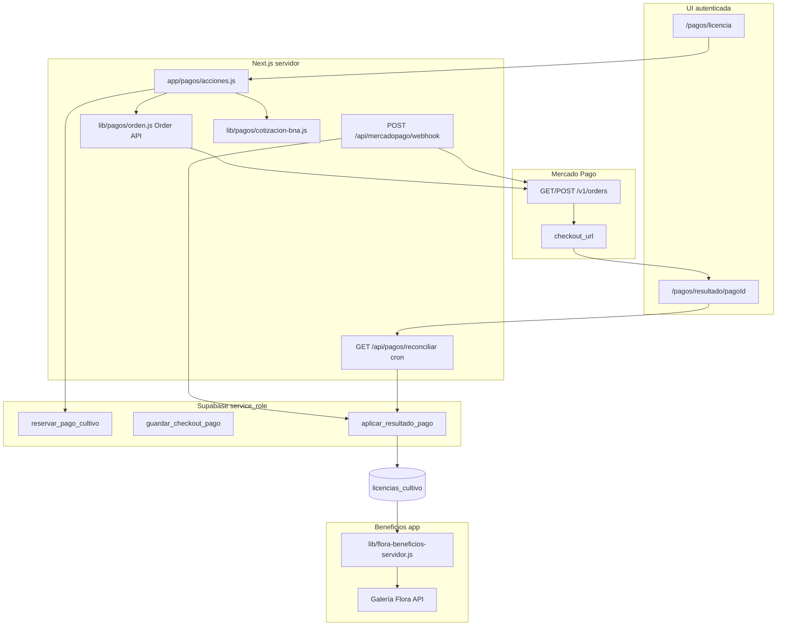

# Auditoría integral — Mercado Pago y sistema comercial ENFLORA (MVP)

**Alcance:** solo lectura sobre código y SQL del repositorio.  
**Fecha:** 30 de octubre de 2026.  
**SDK:** `mercadopago@3.6.1` (Node.js, servidor).

---

## Resumen ejecutivo

| Producto | Cobro | Acreditación automática | Control de beneficios |
|--------|-------|-------------------------|------------------------|
| **Gratuito** | N/A | N/A | Parcial (solo galería Flora acotada en servidor) |
| **Pago único (USD 30 / ciclo)** | **Implementado** (Orders + Checkout Pro) | **Implementado** vía webhook + reconciliación + visita a resultado (consulta MP, no URL) | Parcial (misma resolución “plus” que licencia en galería) |
| **Plus / PLAN 420 (USD 4,20 / mes)** | **No implementado** | **No implementado** | **Stub** (`leerPlusActivo` → siempre `false`) |

El flujo de **licencia por cultivo** está diseñado con buenas prácticas de seguridad (precio en servidor, firma de webhook, consulta de order en MP antes de acreditar, idempotencia por `x-request-id`, RLS restrictiva). Falta cerrar producción (variables, webhook HTTPS, aceptación comercial MP) y **todo el vertical Plus**. Hay **dos fuentes de cotización** (landing vs cobro) con reglas distintas — riesgo de confusión comercial, no de manipulación del checkout.

**No habilitar cobros reales de Plus** hasta modelar suscripciones, webhooks de suscripción y estrategia de actualización de ARS antes de cada renovación.

---

## 1. Arquitectura comercial encontrada



**Decisiones clave:**

- **Checkout productivo:** API **Orders** (`Order.create` / `Order.get`), `processing_mode: manual`, moneda **ARS**, `external_reference` = UUID del pago interno. Documentado en `GUIA_ESTUDIO.md` §16 como Checkout Pro vía Orders (no Preference).
- **Preference:** solo en `POST /api/mercadopago/prueba-preferencia` (desarrollo, ARS 100, verificación de token).
- **Activación de licencia:** exclusivamente `aplicar_resultado_pago` tras evaluar la order remota (`evaluarOrdenRemota` + coincidencia de importe). La URL de retorno **no** acredita.
- **Plus:** copy y precios en `lib/planes.js`; CTA Plus → `/registro` (no checkout). Sin `PreApproval`, sin tablas de suscripción, sin webhooks de suscripción.
- **Cotización para cobrar:** scrape HTML Banco Nación billete **vendedor** (`lib/pagos/cotizacion-bna.js`). Landing usa **dolarapi oficial** (`lib/cotizacion.js`) en horarios 4:20 / 16:20 AR.

---

## 2. Archivos y rutas involucradas

### Mercado Pago y pagos

| Ruta / archivo | Rol |
|----------------|-----|
| `lib/mercadopago.js` | `MercadoPagoConfig`, timeout 5s, prefijos `APP_USR-` / `TEST-` |
| `lib/pagos/ambiente.js` | `MERCADOPAGO_ENV`, `PAYMENTS_LIVE_ENABLED`, correo payer prueba/prod, `APP_URL` |
| `lib/pagos/dinero.js` | USD 30 → centavos ARS, redondeo half-up |
| `lib/pagos/cotizacion-bna.js` | Fuente BNA, vigencia 7 días, cache 15 min |
| `lib/pagos/cuerpo-orden.js` | Payload order, URLs retorno/webhook, idempotency key |
| `lib/pagos/orden.js` | Crear/obtener order |
| `lib/pagos/estados.js` | Mapeo order → `acreditado` / `pendiente` / `rechazado` / reembolso / contracargo |
| `lib/pagos/firma.js` | `WebhookSignatureValidator`, variante `data.id` minúsculas |
| `lib/pagos/evento-webhook.js` | Filtra `order` / `orders` / `orders_v2`; `live_mode` vs ambiente |
| `lib/pagos/aplicar.js` | `aplicarEvaluacion`, `reconciliarPago` |
| `lib/pagos/datos.js` | Supabase **service_role** |
| `lib/pagos/cobertura.js` | `licenciaHabilita` (JS, usado en app y beneficios) |
| `app/pagos/acciones.js` | `iniciarCompra`, `finalizarCiclo` |
| `app/pagos/licencia/page.js` | UI compra |
| `app/pagos/resultado/[pagoId]/page.js` | UI + reconciliación al cargar |
| `app/api/mercadopago/webhook/route.js` | Webhook orders |
| `app/api/pagos/reconciliar/route.js` | Cron horario (hasta 20 pagos pendientes) |
| `app/api/mercadopago/prueba-preferencia/route.js` | Dev only |
| `app/api/mercadopago/diagnostico/route.js` | Dev only |
| `supabase/pagos-licencias.sql` | Esquema + RPC |
| `tests/pagos.test.js` | Pruebas unitarias del núcleo |
| `vercel.json` | Cron reconciliación + cotización landing |
| `proxy.js` | Auth obligatoria en `/pagos/*` |

### Planes, cotización landing y beneficios

| Archivo | Rol |
|---------|-----|
| `lib/planes.js` | Definición comercial Gratuito / Plus / Por cultivo (marketing) |
| `lib/cotizacion.js` | Dolarapi oficial, ventanas 4:20/16:20 |
| `app/api/cotizacion/actualizar/route.js` | Cron landing |
| `lib/flora-beneficios.js` | Nivel gratuito vs plus (galería 12 vs 36) |
| `lib/flora-beneficios-servidor.js` | `resolverBeneficiosFlora`, licencia por unidad ancla, **Plus desactivado** |
| `lib/flora-galeria-fotos-servidor.js` | Aplica límites de tanda en listado |
| `lib/flora-chat-limites.js` | Rate limit chat (igual para todos; no distingue plan) |
| `componentes/landing/tarjeta-plan.js` | CTA por cultivo → `/pagos/licencia`; Plus → registro |

### Documentación interna

- `GUIA_ESTUDIO.md` §§14–16: etapas MP, checkout licencia, webhook, ambientes (alineado con el código revisado).

---

## 3. Tablas y relaciones

Migración: `supabase/pagos-licencias.sql`.

```
auth.users
    └── ciclos_cultivo (usuario_id, unidad_ancla_id, estado activo|finalizado)
            ├── pagos (ciclo_cultivo_id, ambiente, importe_ars, order_id, estado, cotización…)
            │       └── licencias_cultivo (pago_id UNIQUE, una activa por ciclo)
            └── (plantas/registros no referencian ciclo_id directamente)
pagos_notificaciones (clave = x-request-id, idempotencia webhook)
```

**Restricciones relevantes:**

- `pagos.tipo` = `'licencia_cultivo'` únicamente; `precio_usd` fijo 30.00 en CHECK.
- Índice único: un pago `creada`|`pendiente` por `(ciclo_cultivo_id, ambiente)`.
- Índice único: una licencia **activa** por `ciclo_cultivo_id`.
- `licencias_cultivo.pago_id` UNIQUE → una licencia por pago.
- RLS: usuario solo **SELECT** en ciclos, pagos, licencias; escritura vía RPC `service_role`.
- Función SQL `licencia_habilita_ciclo(ciclo, ambiente)` para uso autenticado; la app usa sobre todo `licenciaHabilita` en JS.

**No existen:** tablas `suscripciones`, `planes_mp`, pagos tipo Plus, historial de cotizaciones de cobro aparte de columnas en `pagos`.

---

## 4. Qué ya está implementado

### Pago único (licencia por ciclo)

- Reserva atómica de ciclo + pago (`reservar_pago_cultivo`): ownership unidad/ciclo, bloqueo licencia activa, anti-duplicado checkout abierto.
- Precio USD 30 e importe ARS calculados en servidor; persistidos antes de crear order.
- Order MP con `external_reference` = id pago, idempotency key estable (`pagoId` o `pagoId:hashEmail`).
- Guardado de `order_id`, `checkout_url`, transición `creada` → `pendiente`.
- Webhook: firma HMAC, filtro ambiente `live_mode`, fetch order, validación referencia/moneda/vendedor/importe, RPC idempotente.
- Reconciliación cron + página resultado (relee MP, no confía en query string).
- Reembolso/contracargo confirmado revoca licencia; acreditado no degrada por avisos viejos.
- Separación prueba/producción por columna `ambiente` y `leerRecepcionPagos` vs `leerAmbientePagos`.
- Tests unitarios amplios en `tests/pagos.test.js`.

### Infraestructura MP

- Cliente SDK, diagnóstico local, preferencia de prueba remota (dev).
- Variables documentadas en `.env.example`.

### Beneficios (parcial)

- Resolver central **para galería Flora**: gratuito 12 fotos/tanda, “plus” 36 si licencia válida en unidad ancla **o** Plus activo (Plus nunca activo hoy).
- Licencia atada a **ciclo activo** en la unidad ancla, no a la unidad física reutilizable.

---

## 5. Qué funciona solamente en pruebas (o con limitaciones locales)

| Elemento | Evidencia |
|----------|-----------|
| Creación de orders de cobro | Requiere `MERCADOPAGO_ENV=prueba`, `MERCADOPAGO_PRUEBAS_CONFIRMADAS=true` en dev; `testToken: true` en order |
| Compra end-to-end documentada | `GUIA_ESTUDIO.md` §16: order acreditada 22/10/2026; webhook local sin secreto → reconciliación manual |
| Preferencia ARS 100 | Solo `NODE_ENV=development` |
| Diagnóstico SDK | Solo development, sin llamada remota |
| Licencia “de prueba” | `ambiente=prueba` no habilita beneficios en modo producción (`licenciaHabilita`) |
| Reconciliar cron sin `CRON_SECRET` | Permitido fuera de producción (`reconciliar/route.js`) |
| Filas MP en Supabase compartido | Mismo proyecto; separación lógica por `ambiente` |

**Checkout Pro en producción:** código listo en principio, pero **apagado** por `PAYMENTS_LIVE_ENABLED` ≠ `true` y falta de configuración productiva (credenciales, webhook, aceptación comercial MP según guía).

---

## 6. Qué falta

### Plus / suscripciones (casi todo)

- Modelo de datos (usuario ↔ suscripción MP ↔ estado ↔ próximo cobro).
- Alta checkout suscripción (`PreApproval` / plan).
- Webhooks `subscription_preapproval`, `subscription_authorized_payment` (y consulta a `/preapproval/{id}`, `/authorized_payments/{id}`).
- Cancelación, pausa, reactivación, fallos de cobro, expiración.
- `leerPlusActivo` real.
- UI checkout Plus y post-pago.
- Job previo a renovación: **PUT** `/preapproval/{id}` con `auto_recurring.transaction_amount` en ARS (MP no convierte USD automáticamente).
- Decisión sobre notificaciones: documentación MP indica que **suscripciones** pueden requerir URL de notificación en la **creación** del pago/suscripción, además del panel de integraciones.

### Control de beneficios comercial

- Límites de **9 plantas** (marketing gratuito): no encontrado enforcement server-side acorde a `lib/planes.js`.
- **IA Flora ilimitada** Plus: chat usa rate limit global (`6/min`, `40/h`) sin bypass por plan.
- Resto de features Plus (recordatorios, clima, ADN, etc.): sin gate central por plan detectado.
- Uso de `licencia_habilita_ciclo` en RPCs de otras áreas: solo definida en SQL; poca adopción fuera de pagos/galería.

### Producto / UX comercial

- CTA Plus bloqueado pre-lanzamiento (`lanzamientoPendiente`) hacia modal, no pago.
- Copy FAQ/planes menciona **dólar oficial API**; cobro usa **BNA billete vendedor** — desalineación.

### Operaciones

- Webhook productivo HTTPS en Vercel con secreto de producción.
- Confirmación de migración aplicada (`operacion_mp`, `licencia_habilita_ciclo`) en el proyecto Supabase de producción.
- Playbook de reconciliación manual masiva más allá de 20 filas/hora.
- Tests E2E automatizados de webhook/route handlers (solo unit tests hoy).

---

## 7. Errores y riesgos reales (P0 / P1 / P2)

### P0 — bloquea pagos seguros en producción

| ID | Hallazgo |
|----|----------|
| P0-1 | **`PAYMENTS_LIVE_ENABLED` no activo** y credenciales productivas no desplegadas: no hay cobro real aunque el código exista. |
| P0-2 | **Plus comercialmente prometido en landing sin implementación**: vender PLAN 420 hoy sería manual/fraudulento; no hay cobro ni entitlement. |
| P0-3 | **Webhook sin `MERCADOPAGO_WEBHOOK_SECRET` en prod** → 503 y **ninguna acreditación automática** (dependencia total de reconciliación). |
| P0-4 | **Aceptación comercial Mercado Pago** pendiente (mencionado en guía): habilitar bandera sin esto expone rechazos en prod. |
| P0-5 | **Beneficios Plus no aplicados**: usuario podría pagar suscripción futura y seguir en límites gratuitos (cuando exista cobro). |

### P1 — estabilidad comercial necesaria

| ID | Hallazgo |
|----|----------|
| P1-1 | **Dos cotizaciones** (landing oficial vs cobro BNA vendedor): montos ARS mostrados en home ≠ total en `/pagos/licencia`; riesgo legal/UX. |
| P1-2 | **Suscripciones + renovación ARS**: sin job/webhook que actualice monto antes de cada ciclo, MP cobrará el ARS **congelado** al alta (documentación: solo monto/moneda editables vía PUT preapproval). |
| P1-3 | **Webhooks de suscripción no implementados**; el handler actual **ignora** `payment`, `subscription_*`. |
| P1-4 | **`pagos.tipo` y CHECK USD 30** impiden reutilizar tabla sin migración para Plus. |
| P1-5 | **Reconciliación limitada** (20 registros/hora): cola grande post-incidente puede demorar acreditaciones. |
| P1-6 | **Reembolso parcial** mapeado a `reembolsado` → revoca licencia completa (decisión dura; confirmar con producto). |
| P1-7 | **Modelo un solo ancla por ciclo**: cultivos multi-unidad no cubiertos (documentado; riesgo de soporte). |
| P1-8 | **Rate limit Flora en memoria** (`Map` por instancia serverless): inconsistente entre instancias; no sustituye cuotas comerciales por plan. |
| P1-9 | **Migración Supabase** debe estar aplicada en prod; si falta, `/pagos/licencia` falla al cargar. |

### P2 — mejoras posteriores

| ID | Hallazgo |
|----|----------|
| P2-1 | `NEXT_PUBLIC_MERCADOPAGO_PUBLIC_KEY` sin uso en código (reservado). |
| P2-2 | Sin tabla histórica de cotizaciones de cobro (solo snapshot en `pagos`). |
| P2-3 | Logs dev del webhook incluyen resumen de firma (no secreto); prod loguea solo código. |
| P2-4 | Tests de integración HTTP/webhook ausentes. |
| P2-5 | Scraping HTML BNA frágil ante cambios de markup (mitigado por tests de parseo). |

---

## 8. Estado — Checkout Pro / Orders (pago único)

| Criterio | Estado | Notas |
|----------|--------|-------|
| Creación segura order | **OK** | Servidor + RPC reserva |
| Usuario autenticado | **OK** | `proxy.js`, `obtenerUsuario`, RPC ownership |
| Precio en servidor | **OK** | BNA + `importeLicenciaCentavos` |
| Vínculo pago–usuario–ciclo | **OK** | FK + checks RPC |
| URLs éxito/pendiente/fallo | **OK** | Misma ruta resultado; no activa por URL |
| Pendiente / rechazado | **OK** | `resolverEstadoOrden`, UI TEXTOS |
| Confirmación con MP | **OK** | `obtenerOrden` en webhook, reconciliar, resultado |
| Anti-compra duplicada | **OK** | Índices + licencia activa + reutilizar checkout si `order_id` |
| Idempotencia | **OK** | MP key + `pagos_notificaciones` |
| Preference prod | **N/A** | Solo prueba dev; prod usa Orders |

**Matiz:** el contexto habla de “Checkout Pro”; la implementación productiva es **Orders API** con checkout Pro (coherente con guía interna).

---

## 9. Estado — Suscripciones API (Plus)

| Capacidad | Estado |
|-----------|--------|
| Creación suscripción | **No implementado** |
| Identificación usuario | **No implementado** |
| Activación post-proveedor | **No implementado** |
| Cobros recurrentes / renovación | **No implementado** |
| Fallos / reintentos MP | **No implementado** |
| Cancelación / pausa | **No implementado** |
| Reembolsos suscripción | **No implementado** |
| Vencimiento / expiración | **No implementado** |
| Sync Supabase | **No implementado** |
| SDK `PreApproval` en repo | **Solo mencionado en documentación** |

**Mercado Pago (documentación oficial):**

- Actualización de monto: `PUT /preapproval/{id}` con `auto_recurring.transaction_amount` y `currency_id: "ARS"`.
- Frecuencia/fechas no modificables tras creación.
- Notificaciones: tópicos `subscription_preapproval`, `subscription_authorized_payment`; para suscripciones, la doc advierte limitaciones del panel “Tus integraciones” y uso de URL en creación.

**Riesgo comercial Plus:** cobrar USD 4,20 “en ARS” exige **recalcular y actualizar** el preapproval antes de cada renovación (o recrear suscripción). No hay evidencia de automatización en el repo.

---

## 10. Estado — Webhooks

| Criterio | Estado |
|----------|--------|
| Validación `x-signature` | **OK** (`WebhookSignatureValidator` + fallback minúsculas en `data.id`) |
| Timestamp / replay | **OK** (SDK `TimestampOutOfTolerance`) |
| Uso de `data.id` | **OK** en manifiesto; consulta order con id query |
| Consulta recurso MP antes de acreditar | **OK** |
| Idempotencia duplicados | **OK** (`pagos_notificaciones`) |
| Eventos fuera de orden | **Parcial OK** (`estado_pago_siguiente`) |
| Fallos red → reintento MP | **OK** (503 si no hay order) |
| Persistencia notificaciones | **OK** |
| Logs sin secretos | **OK** en prod |
| Notificación falsa activa plan | **Mitigado** (firma + fetch + importe) |
| Suscripciones | **No cubierto** |

**Gap:** eventos `payment` / `subscription_*` responden 200 ignorado — correcto para no acreditar licencia por error, pero **impide** operar Plus sin ampliar el handler o rutas dedicadas.

---

## 11. Estado — Licencias y ciclos

| Regla producto | Estado |
|----------------|--------|
| Licencia ligada a ciclo | **OK** |
| Vigencia = vida del ciclo | **OK** (sin vencimiento temporal; finalizar ciclo no borra licencia) |
| Anti-duplicado licencia activa | **OK** |
| Activación solo pago confirmado | **OK** |
| Revocación reembolso/contracargo | **OK** |
| Plus + pago único simultáneo | **Diseño OK** (OR en `evaluarNivelBeneficiosFlora`); Plus inactivo hoy |
| Varios cultivos / permisos distintos | **OK** por ciclo/unidad ancla |
| No borrar historial al expirar beneficio | **OK** (revocación marca estado, no DELETE) |
| Licencia en otro ciclo | **OK** bloqueado (pago acreditado atado a `ciclo_cultivo_id`) |
| Beneficio en unidad sin ciclo activo licenciado | **OK** (`licenciaActivaParaUnidadAncla` solo ciclos activos) |

---

## 12. Estado — Conversión Banco Nación

| Aspecto | Implementación cobro | Landing precios |
|---------|----------------------|-----------------|
| Fuente | HTML BNA Personas billete | API dolarapi oficial |
| Punta | Vendedor | Venta oficial |
| Horario | Timestamp parseado del HTML | Ventanas 4:20 / 16:20 AR |
| Vigencia | 7 días + cache 15 min | Revalidate hasta próxima ventana |
| Cálculo USD 30 | BigInt half-up → `pagos.importe_ars` | `convertirUsdAArs` float |
| Histórico | Columnas en `pagos` | Cache Next tags |
| Fallo fuente | Bloquea compra | Muestra sin ARS |
| Manipulación frontend | **Imposible** (importe server-side) | N/A |
| Plus renovación | **No aplica** (sin suscripción) | N/A |

**Recomendación de producto (sin implementar):** unificar criterio comercial BNA vendedor para **toda** comunicación de precios en ARS, o disclaimer explícito en landing.

---

## 13. Estado — Control de beneficios

| Área | Mecanismo | Gratuito | Plus | Pago único / ciclo |
|------|-----------|----------|------|---------------------|
| Galería Flora (tanda fotos) | `resolverBeneficiosFlora` | 12 | 36 (si Plus) | 36 si licencia en unidad |
| Flora chat cuotas | `verificarCuotaUsuario` | Límite global | **Mismo límite** | **Mismo límite** |
| Plantas por cultivo | — | **No enforce 9** | **No enforce** | **No enforce** |
| Resto features Plus | — | — | **No gate** | **No gate** |

**Conclusión:** existe un **núcleo** de resolver (`lib/flora-beneficios-servidor.js` + `lib/pagos/cobertura.js`), pero **no** es la única fuente de verdad comercial en toda la app. Decisiones sensibles de galería están en servidor; chat y plantas no reflejan planes.

---

## 14. Variables necesarias en producción

| Variable | Obligatoria | Notas |
|----------|-------------|-------|
| `MERCADOPAGO_ACCESS_TOKEN` | Sí | `APP_USR-` producción |
| `MERCADOPAGO_WEBHOOK_SECRET` | Sí | Pestaña producción; distinta de prueba |
| `MERCADOPAGO_ENV` | Sí | `produccion` |
| `PAYMENTS_LIVE_ENABLED` | Sí | Exactamente `true` para vender |
| `APP_URL` | Sí | `https://enflora.com.ar` |
| `NEXT_PUBLIC_SUPABASE_URL` | Sí | |
| `SUPABASE_SERVICE_ROLE_KEY` | Sí | Solo server; pagos/webhook |
| `CRON_SECRET` | Sí en prod | Reconciliación + cotización |
| `NEXT_PUBLIC_MERCADOPAGO_PUBLIC_KEY` | Cuando haya flujo cliente MP | Hoy sin uso |
| **No en prod** | | `MERCADOPAGO_PRUEBAS_CONFIRMADAS`, `MERCADOPAGO_TEST_BUYER_EMAIL` |

---

## 15. Plan de corrección por fases (orden recomendado)

### Fase 0 — Pre-requisitos operativos (pago único prod)

1. Verificar migración `pagos-licencias.sql` aplicada (tablas, RPC, `licencia_habilita_ciclo`, `operacion_mp`).
2. Configurar en Vercel prod: token, webhook secret, `MERCADOPAGO_ENV=produccion`, `APP_URL`, `CRON_SECRET`.
3. Registrar webhook **Order** en MP producción → `https://enflora.com.ar/api/mercadopago/webhook`.
4. Prueba de punta a punta en **prueba** con secreto webhook y túnel/host de prueba (checklist §16 guía).
5. Obtener aceptación comercial MP; recién entonces `PAYMENTS_LIVE_ENABLED=true` y deploy.
6. Smoke prod con pagos deshabilitados: webhook + reconciliar responden sin crear orders.

### Fase 1 — Cierre comercial pago único

1. Alinear copy landing/FAQ con BNA vendedor (o mostrar ambos con roles claros).
2. Ampliar reconciliación (lote/paginación/backoff) y alertas si pendientes > N horas.
3. Runbook soporte: reembolsos vía MP, efecto en licencia, recompra mismo ciclo.
4. Tests integración webhook (firma simulada + mock MP) en CI.

### Fase 2 — Diseño Plus (sin cobrar hasta aprobación)

1. Spec producto: entitlements Plus vs licencia ciclo; combinación; fallos de pago.
2. Migración SQL: suscripciones, pagos recurrentes, ampliar `pagos.tipo` o tabla nueva.
3. Unificar cotización BNA para alta y **job de actualización pre-renovación** (PUT preapproval).
4. Definir URL de notificación en creación de suscripción + eventos a suscribir.

### Fase 3 — Implementación Plus MVP

1. Checkout alta `PreApproval` (USD 4,20 → ARS servidor).
2. Webhooks `subscription_preapproval` + `subscription_authorized_payment` con mismo patrón: firma → GET recurso → RPC idempotente.
3. Implementar `leerPlusActivo` y persistencia estado (`authorized`, `paused`, `cancelled`, past_due).
4. UI `/pagos/plus` (o equivalente) + enlaces desde landing post-lanzamiento.
5. Cancelación self-service mínima (PUT status `cancelled`).

### Fase 4 — Control de beneficios

1. Extender `resolverBeneficiosFlora` (o módulo `lib/comercial/entitlements.js`) como **única** API server-side.
2. Enchufar Flora chat, plantas, y demás features aprobados **solo** tras definición explícita de cuotas.
3. Tests de aceptación por nivel (gratuito / licencia ciclo / Plus).

### Fase 5 — Hardening

1. Tabla audit cotización usada por cobro.
2. Métricas: webhook 401/503, lag reconciliación, tasa revocación.
3. Revisión reembolso parcial vs revocación total.

---

## 16. Bloqueantes para habilitar cobros reales

### Pago único (USD 30)

- [ ] Migración pagos en Supabase prod verificada  
- [ ] Credenciales MP **producción** en Vercel  
- [ ] Webhook prod configurado + secreto  
- [ ] `CRON_SECRET` + cron reconciliar activo  
- [ ] Prueba acreditada en ambiente prueba **con** webhook o reconciliación validada  
- [ ] Aceptación comercial MP  
- [ ] `PAYMENTS_LIVE_ENABLED=true` (deliberado)  
- [ ] Copy cotización alineado con BNA vendedor (P1 recomendado antes de marketing masivo)

### Plus (USD 4,20 / mes)

- [ ] **Todo lo anterior es insuficiente**  
- [ ] Modelo datos + RPC + webhooks suscripción  
- [ ] Estrategia probada de **actualización ARS pre-renovación**  
- [ ] `leerPlusActivo` + gates de features acordados con producto  
- [ ] Aprobación explícita de negocio para precio y política de fallos de renovación  

---

## 17. Preparación de pruebas de aceptación

Leyenda: **A** automatizable (unit/integration), **S** simulada (mock MP / RPC), **R** real proveedor (sandbox/prod controlado).

| # | Escenario | Tipo sugerido |
|---|-----------|---------------|
| 1 | Usuario Gratuito (beneficios base) | A + manual |
| 2 | Compra aprobada pago único | R prueba + S webhook |
| 3 | Pago pendiente | R / S |
| 4 | Pago rechazado | R / S |
| 5 | Pago duplicado mismo ciclo | A (índices) + R |
| 6 | Webhook duplicado mismo `x-request-id` | A + S |
| 7 | Webhook firma falsa | A (`firmaWebhookValida`) + S |
| 8 | Compra ciclo específico | R |
| 9 | Beneficios en otro ciclo/unidad | A (`licenciaHabilita`) + manual |
| 10 | Alta Plus | **R** (tras Fase 3) |
| 11 | Renovación exitosa | **R** + job PUT monto |
| 12 | Renovación fallida | **R** |
| 13 | Cancelación suscripción | **R** |
| 14 | Reembolso pago único | R + A estado |
| 15 | Suscripción expirada | **R** |
| 16 | Plus + pago único simultáneo | S + manual |
| 17 | Error consulta BNA | A (`evaluarCotizacion`) + S fetch |
| 18 | Conversión ARS renovación Plus | **S/R** (PUT preapproval) |
| 19 | Error red durante acreditación | S (503 webhook) + reconciliar |
| 20 | Reconciliación pagos sin webhook | R cron / GET reconciliar |
| 21 | Acceso pagos/licencias otra cuenta | Manual RLS + proxy |
| 22 | Prod con `PAYMENTS_LIVE_ENABLED` off | A (`leerAmbientePagos`) + manual |

**Cobertura actual automatizada:** lógica pura en `tests/pagos.test.js` y `tests/flora-galeria-fotos.test.js` (beneficios galería). **No** hay tests del route handler webhook ni E2E checkout.

---

## 18. Orden exacto de implementación recomendado (post-auditoría)

1. **Fase 0** completa (infra pago único producción apagada pero webhook/cron listos).  
2. **Fase 1** (copy cotización, reconciliación, runbook).  
3. **Habilitar solo pago único** (`PAYMENTS_LIVE_ENABLED`) tras checklist §16 pago único.  
4. **Fase 2** diseño Plus + migración + estrategia ARS renovación (**aprobación negocio**).  
5. **Fase 3** implementación Plus end-to-end en sandbox.  
6. **Fase 4** entitlements centralizados (features acordados).  
7. **Habilitar cobro Plus** en producción.  
8. **Fase 5** hardening y observabilidad.

**No iniciar modificaciones de código de esta auditoría** hasta priorizar explícitamente la fase elegida.

---

## Referencias en repo

- Guía operativa: `GUIA_ESTUDIO.md` §§14–16  
- SQL: `supabase/pagos-licencias.sql`  
- Tests pagos: `tests/pagos.test.js`  
- Cron: `vercel.json` → `/api/pagos/reconciliar` (min 15)  

## Referencias Mercado Pago (externas)

- [Gestión de suscripciones — modificar monto](https://www.mercadopago.com.ar/developers/es/docs/subscriptions/subscription-management)  
- [PUT preapproval](https://www.mercadopago.com.ar/developers/es/reference/online-payments/subscriptions/update-preapproval/put)  
- [Webhooks — tópicos y validación](https://www.mercadopago.com.ar/developers/es/docs/your-integrations/notifications/webhooks)  

---

## 19. Seguimiento — Sprint Comercial iteración 1 (Pago único)

**Fecha:** 30 de octubre de 2026.  
**Alcance:** Fases 0–1 de la auditoría (sin Plus, sin `PAYMENTS_LIVE_ENABLED`, sin cobros reales).  
**Runbook operativo:** `auditorias/RUNBOOK-PAGO-UNICO.md`

### 1. Correcciones implementadas

| Área | Cambio |
|------|--------|
| **Cotización comercial** | Landing, FAQ y modal usan la misma fuente que el checkout: BNA billete vendedor (`lib/pagos/cotizacion-comercial.js`). Conversión USD→ARS en landing con la misma regla half-up que el cobro. |
| **Antigüedad cotización** | Documentados `DIAS_VIGENCIA_COTIZACION = 7` y `DIAS_ALERTA_COTIZACION = 3`. Tras 7 días no se cobra ni se muestra ARS referencial; entre 3 y 7 días hay advertencia en `/pagos/licencia`. |
| **Cron landing** | `/api/cotizacion/actualizar` refresca cache BNA (deja de depender de dolarapi para precios). |
| **Webhooks** | Lógica extraída a `lib/pagos/procesar-webhook-orden.js` (testeable). Route handler delega en el procesador. |
| **Idempotencia** | `aplicacionDuplicadaTerminal` evita re-ejecutar RPC cuando el pago ya está en un estado terminal coherente con MP (reintentos con distinto `x-request-id`). |
| **Infra** | `lib/pagos/infra-diagnostico.js` + `PASOS_MANUALES_INFRA` para checklist sin exponer secretos. |
| **Soporte** | Runbook de recuperación manual. |

### 2. Archivos modificados o agregados

**Nuevos:** `lib/pagos/cotizacion-comercial.js`, `lib/pagos/procesar-webhook-orden.js`, `lib/pagos/infra-diagnostico.js`, `auditorias/RUNBOOK-PAGO-UNICO.md`, `tests/pagos-cotizacion-comercial.test.js`, `tests/pagos-rutas.test.js`

**Modificados:** `lib/pagos/dinero.js`, `lib/pagos/cotizacion-bna.js`, `lib/pagos/estados.js`, `lib/pagos/aplicar.js`, `app/api/mercadopago/webhook/route.js`, `app/api/cotizacion/actualizar/route.js`, `app/page.js`, `lib/planes.js`, `app/pagos/licencia/page.js`, `componentes/landing/*` (precios, FAQ, modal, tarjeta-plan), `tests/pagos.test.js`, `package.json` (script test)

**Sin cambios de esquema SQL** (migración no ejecutada en esta iteración).

### 3. Pruebas automatizadas

| Suite | Resultado | Tipo |
|-------|-----------|------|
| `tests/pagos.test.js` (27 casos) | **Pass** | Simulada (unit) |
| `tests/pagos-cotizacion-comercial.test.js` (4) | **Pass** | Simulada |
| `tests/pagos-rutas.test.js` (7) | **Pass** | Simulada (route + procesador con deps mock) |
| `pnpm build` | **Pass** | Build |
| ESLint focalizado pagos | 1 error preexistente en `tarjeta-plan.js` (regla `react-hooks/set-state-in-effect`, no introducido por esta iteración) | — |

**Prueba real MP / webhook HTTPS:** no ejecutada en esta iteración (requiere túnel + secreto + compra sandbox autorizada).

### 4. Configuraciones externas pendientes (no verificadas como completas)

| Paso | Estado | Verificación manual |
|------|--------|---------------------|
| Migración `supabase/pagos-licencias.sql` en proyecto Supabase de la app | **No comprobado** (sin acceso SQL en esta sesión) | SQL Editor: query tablas/RPC del §16 `GUIA_ESTUDIO.md` |
| Webhook Order HTTPS en MP (prueba y prod) | **No comprobado** | Panel MP → URL `{APP_URL}/api/mercadopago/webhook` + secreto en Vercel |
| `MERCADOPAGO_WEBHOOK_SECRET` en entorno desplegado | **No comprobado** | Solo presencia booleana vía `diagnosticarInfraPagoUnico` en deploy |
| `CRON_SECRET` en Vercel producción | **No comprobado** | Cron reconciliar 401 sin header |
| Credenciales prod en Vercel | **No modificado / no verificado** | Pares distintos prueba vs producción |
| Aceptación comercial MP | **Pendiente negocio** | Panel MP |

**Diagnóstico local (código implementado, env del dev):** ejecutar en el proyecto `diagnosticarInfraPagoUnico(process.env)` — reporta presencia de token, `MERCADOPAGO_ENV`, flags y URLs esperadas **sin imprimir secretos**.

### 5. Estado webhook

| Ítem | Estado |
|------|--------|
| Validación firma + `data.id` | Código OK — prueba simulada |
| Consulta order antes de acreditar | Código OK — prueba simulada |
| Idempotencia `x-request-id` | Código OK — prueba simulada |
| Idempotencia estado terminal (otro request id) | **Implementado** — prueba simulada |
| Webhook prod recibiendo tráfico | **No verificado** |

### 6. Estado cotización BNA

| Ítem | Estado |
|------|--------|
| Checkout usa BNA vendedor | Código OK (sin cambio de regla) |
| Landing alineada a BNA | **Implementado** |
| Máx. 7 días / alerta 3 días | **Implementado y documentado** |
| Snapshot en `pagos` al reservar | Sin cambio (OK) |
| Fetch BNA en vivo en CI/build | Depende de red BNA al renderizar `/` |

### 7. Estado licencias

| Regla | Estado |
|-------|--------|
| Una licencia activa por ciclo | SQL + tests unitarios OK |
| Activación solo RPC tras MP | Sin cambio — OK |
| Revocación reembolso/contracargo | Tests unitarios OK |
| Recompra / duplicados | Índices + `aplicacionDuplicadaTerminal` — OK en código |

### 8. Checklist final para habilitar Pago único (solo pago único)

- [ ] Ejecutar/verificar migración Supabase en prod  
- [ ] Configurar webhook Order + secreto en MP y Vercel (prod)  
- [ ] Configurar `CRON_SECRET` y validar cron reconciliar  
- [ ] Credenciales **producción** MP en Vercel (`MERCADOPAGO_ENV=produccion`)  
- [ ] Compra sandbox **real** con webhook o reconciliación documentada  
- [ ] Aceptación comercial MP  
- [ ] Revisión legal copy BNA en landing y checkout  
- [ ] **Recién entonces** `PAYMENTS_LIVE_ENABLED=true` + deploy  

### 9. Riesgos / bloqueantes abiertos

| Prioridad | Item |
|-----------|------|
| P0 | Webhook/secreto y migración Supabase no verificados en prod |
| P0 | Aceptación comercial MP |
| P1 | Reconciliación limitada a 20 filas/hora |
| P1 | Reembolso parcial revoca licencia completa (confirmar producto) |
| P1 | Plus sigue sin implementar (fuera de alcance iteración 1) |
| P2 | Scraping HTML BNA frágil ante cambios de markup |

### Leyenda de evidencia

- **Código implementado:** merge en repo, sin verificación operativa externa.  
- **Prueba simulada satisfactoria:** tests Node / mocks.  
- **Prueba real satisfactoria:** no alcanzada en esta iteración para webhook/checkout MP.  
- **Configuración producción verificada:** ninguna marcada como completa aquí.
